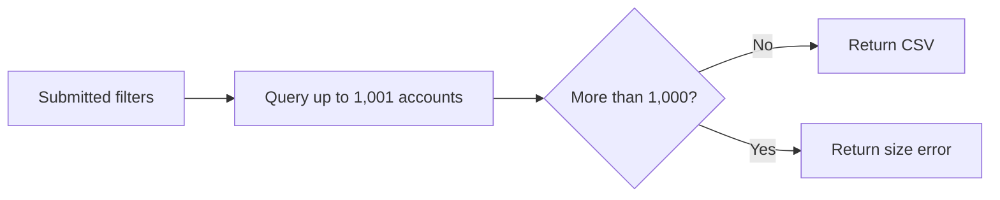
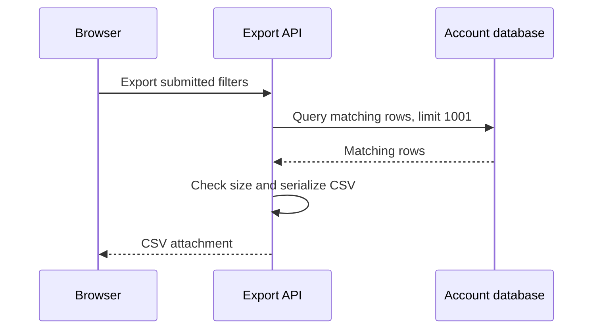
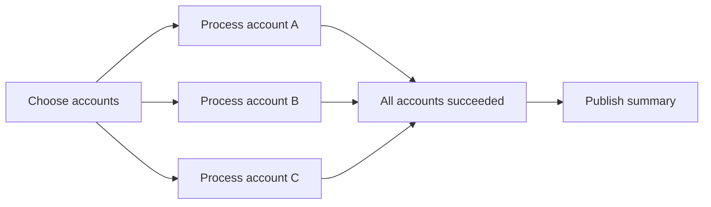
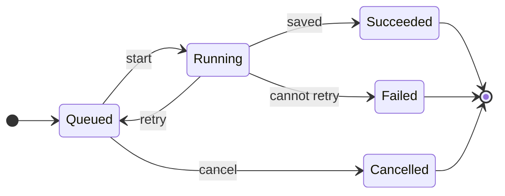

# Explain Visually

Choose the representation that makes the relevant behavior, relationships, or structure clear. Concrete requests and responses can help someone assess a proposed API or understand a third-party interface; a sequence diagram can clarify how services interact. Include the context and detail the reader needs to understand it. Use multiple views when they explain different aspects of the topic. Use prose to connect the examples and explain the reasoning, implications, and qualifications the visuals cannot convey on their own.

Place each view beside the explanation it supports. Make the main point visible in the example itself and supply the context needed to interpret its labels. When prose describes a comparison, sequence, or relationship, consider whether a visual would make it easier to follow. Remove prose that only repeats what the visual already makes clear.

Preserve the roles, ordering, boundaries, and values needed to understand the behavior. Label illustrative or shortened examples, distinguish existing behavior from proposed behavior, and keep expected results separate from observed evidence.

The examples below are fictional. Most use an account-export feature that downloads matching accounts as CSV, with a 1,000-account limit. Each example can be read independently. Examples of background work, testing, and measurements introduce their own context where it helps demonstrate a different relationship.

## Pseudocode: make a decision visible

The export checks its size before creating the CSV, so an oversized result produces an error instead of a partial download.

```text
exportAccounts(filters):
    rows = findMatchingAccounts(filters, limit = 1001)
    if rows.length > 1000:
        return error("Narrow your filters")
    return csv(rows)
```

Reading one extra row distinguishes a complete 1,000-row result from an oversized result. Keep incidental helper calls out of this view.

## Commands: show the operation and its result

The command uses the submitted filter and reports where it wrote the file. Illustrative terminal output:

```console
$ atlas accounts export --status active --output /tmp/accounts.csv
Wrote 2 matching accounts to /tmp/accounts.csv

$ cat /tmp/accounts.csv
id,name,status
acct_12,Acme Labs,active
acct_31,Acme West,active
```

Include the working directory or prerequisites when they affect how someone invokes the command. Distinguish output recorded during verification from an expected result shown to explain the interface.

## Input and output: show the interface

The list tool returns only accounts matching the requested status. Illustrative call and response:

```json
{
  "tool": "list_accounts",
  "arguments": { "status": "active" }
}
```

```json
{
  "accounts": [
    { "id": "acct_12", "name": "Acme Labs", "status": "active" },
    { "id": "acct_31", "name": "Acme West", "status": "active" }
  ]
}
```

Show the fields that determine behavior, preserving their names and value types. Include enough surrounding code or data to make the example understandable. Show the complete relevant function, record, or configuration when an excerpt would hide how its parts fit together. For a data transformation, the same technique can show source rows beside the records they produce.

## Mermaid: show flow and responsibility

The size check decides whether the request returns a download or an error:



A sequence diagram answers a different question: which component does each part of the work? This sketch shows the successful path.



Choose the view that answers the reader’s question. A flowchart makes decisions and paths visible; a sequence diagram makes participants and ordering visible. Use both when those aspects each need explanation. Keep labels meaningful, use a consistent direction, and make arrow meanings clear. Show important boundaries and handoffs, including dependencies or failure paths needed to understand the behavior. Label a successful-path sketch when failures are omitted.

Keep diagrams easy to follow, with detail where the explanation requires it. Separate views when they answer different questions, rather than removing relationships the reader needs. Inspect the rendered diagram when a preview is available, checking labels, layout, and agreement with the behavior being explained. Use a text diagram if the destination cannot render Mermaid.

## Parallel work: show what must finish together

A daily report processes three accounts independently and publishes a summary only after every account succeeds. This diagram shows the successful path and the condition for publication:



Each branch represents independent work. Label the condition that allows the next step to run, such as all branches succeeding or enough results arriving. If one account fails permanently in this example, publication stays blocked. Show failure handling separately when it is part of the question being explained.

## States: show what can happen next

A background import returns to the queue after a retryable failure while attempts remain. It can be cancelled while queued. Success, a failure that cannot be retried, and cancellation end the job.



Label transitions with the event or condition that causes them. Include the states and paths relevant to the behavior under discussion. A state diagram answers which transitions are allowed; a sequence diagram answers which components perform them.

## ASCII diagrams and call trees: show a compact path

The route reuses the account query and CSV serializer. This call tree identifies its main calls:

```text
handleAccountExport
├── requireOrganizationAccess
├── parseAccountFilters
├── findMatchingAccounts
├── checkExportSize
└── serializeCsv
```

For a simple data path, a single line may be enough:

```text
submitted filters -> matching account rows -> CSV attachment
```

A call tree shows nesting. Use numbered steps or arrows when execution order or concurrency is the important part.

## Timelines: show intervals and overlap

A backfill processes 90 days of history in three sequential windows. Each window after the first includes one day from the preceding window. Illustrative data ranges, with schematic spacing:

```text
Window 1: day  0 --------- day 30
Window 2:              day 29 --------- day 60
Window 3:                           day 59 --------- day 90
```

Staggered rows make the progression easy to follow, while explicit endpoints make the one-day overlap precise. Use a shared horizontal direction to show intervals, gaps, or overlap. Identify what the timeline measures, such as the data covered by a job or the time it spends executing.

### Event traces: connect actions to saved progress

A batch import retries its failed second batch while retaining the first batch's result. An illustrative trace makes the retry and the resulting state visible together:

```text
Elapsed   Action                         Saved batches
0.0 s     Store batch 1                  [1]
0.4 s     Batch 2 fails                  [1]
1.4 s     Retry stores batch 2           [1, 2]
1.8 s     Store batch 3                  [1, 2, 3]
```

Use this view when the order of events and the state after each event explain recovery, retries, or duplicate work. Keep recorded traces distinct from illustrative sequences, and include operation identifiers when events from several operations are interleaved.

## File and component trees: show ownership

The route handles HTTP, the account module owns queries, and the shared serializer owns CSV encoding. Illustrative file layout:

```text
src/
├── routes/
│   └── account-export.ts     # HTTP input and response
├── accounts/
│   └── query.ts              # filtering and row selection
└── shared/
    └── csv.ts                # CSV encoding
```

A component sketch can show which part of the page owns the selected filters and where export sits. This is a structure sketch, not executable TSX:

```text
AccountSearchPage                 owns submitted filters
├── AccountFilters                submits filter changes
├── ResultsToolbar
│   └── ExportButton              receives submitted filters
└── AccountResults                displays matching rows
```

Show enough of the tree to establish the relevant boundaries. Explain individual file responsibilities or changes beside it when those need more detail.

## Boundary diagrams: show what runs where

An integration test runs the real API and order repository against a disposable database. It replaces the email provider with a fake:

```text
+-- Test process ----------------+       +-- Disposable database ---+
| API -> order repository        |--SQL->| Real SQL and migrations  |
| Email provider: fake           |       | Isolated order data      |
+--------------------------------+       +--------------------------+
```

This view makes the test's scope visible: it checks the API and persistence together, while email delivery remains outside the proof. Use boxes for meaningful process, environment, ownership, or trust boundaries. Label the connections with what crosses them. A box containing several components indicates grouping; use arrows when their interactions matter.

## Data relationships: show how records connect

Each export job belongs to one organization. An organization can have no export jobs or many:

```text
organizations                  export_jobs
-------------                  -----------------------
id (primary key) <------------ organization_id (foreign key)
name                           id (primary key)
                               status

One organization -> zero or more export jobs
One export job   -> exactly one organization
```

The connecting line identifies the stored reference; the two statements describe how many records can be related. Show relevant identifiers, optional relationships, and uniqueness constraints when they affect the design. Leave unrelated columns out. Use a Mermaid entity-relationship diagram when a larger set of relationships is easier to follow that way.

## Diffs: make the changed parts visible

The export uses the same filters but no longer limits the result to the current page. Simplified pseudocode comparison:

```diff
-exportAccounts(filters, currentPage):
+exportAccounts(filters):
-    rows = findPage(filters, currentPage)
+    rows = findMatchingAccounts(filters, limit = 1001)
+    if rows.length > 1000:
+        return error("Narrow your filters")
     return csv(rows)
```

Diffs also work for records, commands, component trees, and file layouts. Keep enough unchanged context to show where the change belongs, following the same guidance as the code and record examples above. A new capability may be clearer as a complete input/output example than as an all-added diff.

## Tables: compare behavior under the same conditions

An export should contain all matching rows, regardless of which page is visible. In this illustrative case, 42 accounts match and each page displays up to 25:

| Action             | Before                    | After                    |
| ------------------ | ------------------------- | ------------------------ |
| Export from page 1 | The first 25 accounts     | All 42 matching accounts |
| Export from page 2 | The remaining 17 accounts | All 42 matching accounts |

For a new capability, demonstrate its use without inventing an earlier implementation:

| Capability | Example |
| --- | --- |
| Export matching accounts | Select the active-account filter, then choose Export CSV. The file contains the accounts matching that filter. |

Use column names that describe their contents. Keep multi-step reasoning in prose when table cells become difficult to scan.

## Quantitative comparisons: show magnitude

These fictional measurements compare the 95th-percentile latency of an API before and after a change under the same workload. A text bar chart shows the size of the difference:

```text
95th-percentile latency (ms)     Each # represents 50 ms

Before  ####################    1,000 ms
After   #####                     250 ms
```

Label the metric, units, scale, and relevant measurement conditions. Keep exact values beside the marks. A bar chart compares magnitudes; a line chart shows change over time; a histogram shows how observations are distributed. Choose the view for the claim, and preserve distinctions that matter, such as typical latency versus slow requests. For larger datasets or publication-quality figures, use plotting tools rather than hand-drawn bars. Keep illustrative numbers separate from measured evidence.

## ASCII wireframes: show placement

The export action sits beside the filters that determine its contents. A text wireframe makes that relationship visible without specifying visual styling. Illustrative layout sketch:

```text
+------------------------------------------------+
| Accounts                                       |
| Status: [Active v]                [Export CSV] |
|                                                |
| Name                              Status       |
| Acme Labs                         Active       |
| Acme West                         Active       |
+------------------------------------------------+
```

## Screenshots and videos: show the actual interface

Capture a screenshot or video if the client supports it and the actual UI state helps explain the topic. Include enough of the surrounding page to locate the control or result, and describe the action that produced it. For the export example, show the selected filter and the export action together. Identify the relevant environment and state. Keep what the image or video shows distinct from any proposed behavior.

Pair screenshots and videos with downloaded files, persisted state, or other evidence when the claim concerns behavior beyond the image or video.
